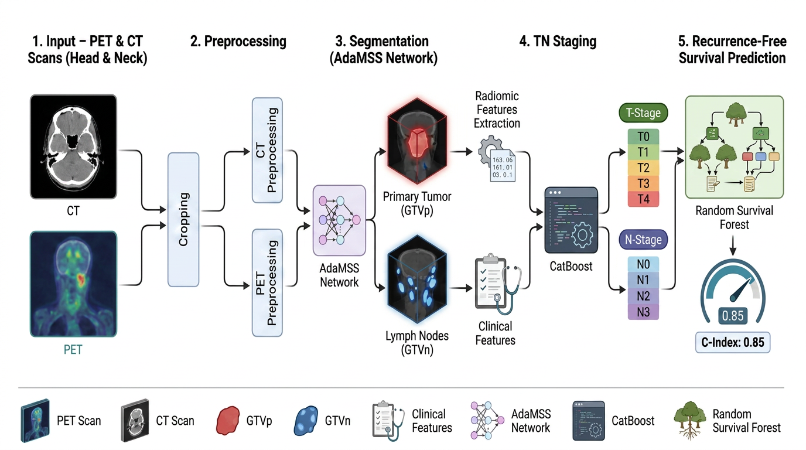

# Deep Learning-Based Segmentation and Feature-Based Clinical Prediction for Head and Neck Cancer

**Authors:** [Yasar Mehmood](https://orcid.org/0000-0002-2891-9129)¹ · [Christian Anchele Hu](https://orcid.org/0009-0007-2821-830X)² · [Maryam Fatima Zaidi](https://orcid.org/0009-0009-7679-2394)²

**Affiliations:**  
¹ Department of Computer Science, Information Technology University, Lahore, Punjab, Pakistan — yasar.mehmood111@gmail.com  
² University of Stirling RAK

**Team name:** Segment Pioneers

**Status:** Companion code for the MICCAI 2026 HECKTOR Challenge paper (5th place; open-access camera-ready available).

## Paper

Yasar Mehmood, Christian Anchele Hu, and Maryam Fatima Zaidi.  
*Deep Learning-Based Segmentation and Feature-Based Clinical Prediction for Head and Neck Cancer.*  
MICCAI 2026 Workshops and Challenges (HECKTOR), LNCS 17271, 2026. **5th place.**

- **Open-access PDF:** https://papers.miccai.org/miccai-2026-sat/paper/HECKTOR_003.pdf
- **Paper page:** https://papers.miccai.org/miccai-2026-sat/HECKTOR_003.html
- **OpenReview:** https://openreview.net/forum?id=IeaB6Z0Kf8

```bibtex
@InProceedings{MehYas_Deep_MICCAISAT2026,
  author    = {Mehmood, Yasar and Hu, Christian Anchele and Zaidi, Maryam Fatima},
  title     = {Deep Learning-Based Segmentation and Feature-Based Clinical Prediction for Head and Neck Cancer},
  booktitle = {Medical Image Computing and Computer Assisted Intervention -- MICCAI 2026 Workshops and Challenges},
  year      = {2026},
  publisher = {Springer Nature Switzerland},
  volume    = {LNCS 17271}
}
```

## Abstract

Head and neck cancer (HNC) management requires accurate tumor delineation, disease staging, and prognosis to support clinical decision-making. The HEad and neCK TumOR (HECKTOR) 2026 challenge addresses these tasks by introducing a unified benchmark for primary tumor (GTVp) and metastatic lymph node (GTVn) segmentation, TN staging, and recurrence-free survival (RFS) prediction from multimodal PET/CT imaging and clinical data. We propose a modular framework integrating established methods for segmentation, TN staging, and RFS prediction. For segmentation, we adopt the Adaptive Multi-modality Segmentation-to-Survival model (AdaMSS), which learns an adaptive fusion strategy for combining complementary anatomical information from CT and metabolic information from PET. To enable fully automatic inference, the original ground-truth-based cropping strategy of AdaMSS is replaced with a scan-specific anatomical-prior localization procedure. TN staging uses independent CatBoost classifiers trained on compact handcrafted radiomic, anatomical, and clinical features. Finally, RFS prediction uses a Random Survival Forest integrating segmentation-derived features, clinical variables, and probability distributions from the TN staging models. On the HECKTOR 2026 validation set, the framework achieved a weighted score of 0.6630, Mean Dice of 0.6388, T-stage and N-stage balanced accuracies of 0.6155 and 0.5379, respectively, and an RFS C-index of 0.7536. On the held-out test set, it achieved a weighted score of 0.5920, Mean Dice of 0.6386, T-stage and N-stage balanced accuracies of 0.5237 and 0.6032, respectively, and an RFS C-index of 0.5879, placing the team **5th** among challenge submissions. These results support the feasibility of integrating established methods within a unified modular framework.



# Reproducing the Experiments

The following steps reproduce the complete five-fold cross-validation pipeline used in this study. The commands below illustrate the workflow for **Fold 1**. The same procedure should be repeated for the remaining folds by replacing the corresponding training and validation split files and output directories.

It is assumed that the HECKTOR 2026 dataset has already been downloaded from the official challenge website and preprocessed according to the instructions in [`src/preprocessing/README.md`](src/preprocessing/README.md).

## 1. Clone the Repository

Clone the repository and navigate to its root directory.

```bash
git clone https://github.com/segment-pioneers/hecktor2026
cd hecktor2026
```

## 2. Create a Python Environment

It is strongly recommended to create a new Python environment before installing the required packages, as **imgaug** is incompatible with recent NumPy releases.

```bash
python -m venv hecktor_env
source hecktor_env/bin/activate      # Linux/macOS
```

or

```bash
conda create -n hecktor python=3.10
conda activate hecktor
```

Install the required dependencies:

```bash
pip install -r requirements.txt
```

## 3. Preprocess the Data

See [`src/preprocessing/README.md`](src/preprocessing/README.md) for the preprocessing pipeline and anatomical-prior crop coverage analysis.

Before training, run `src/preprocessing/Preprocess_224.ipynb`.
- Set `ROOT` to the raw HECKTOR data root and `DESTINATION` to the output folder for preprocessed `.npz` files.
- Run all cells to resample to 1 mm isotropic and produce 224³ NPZ volumes.
Use `DESTINATION` as `--data_dir` `/path/to/preprocessed_data/` in the following sections.

## 4. Navigate to the Source Directory

```bash
cd src
```

## 5. Configure the Python Package Path

This only needs to be executed once per terminal session.

```bash
export PYTHONPATH="$(pwd):$PYTHONPATH"
```

## 6. Segmentation

Train the AdaMSS segmentation model for Fold 1.

```bash
python -m segmentation.train_seg \
    --data_dir /path/to/preprocessed_data/ \
    --train_samples /path/to/data_splits/fold1_train.npy \
    --valid_samples /path/to/data_splits/fold1_valid.npy \
    --model_dir /path/to/output/segmentation/fold1/ \
    --log_dir /path/to/output/segmentation/fold1/logs/ \
    --epochs 50 \
    --steps_per_epoch 200 \
    --batch_size 2 \
    --device gpu0
```

## 7. TN Stage Classification

### 7.1 Extract Handcrafted Features

Extract handcrafted radiomic, anatomical, and clinical features from the preprocessed data. By default, masks are taken from the NPZ **ground-truth** `MASK` (`--mask_source ground_truth`). The complete named feature lists (TN: 37; RFS: 41) and missing-value handling are documented in [`src/FEATURES.md`](src/FEATURES.md).

```bash
python -m tn_staging.extract_tn_features \
    --data_dir /path/to/preprocessed_data/ \
    --clinical_csv /path/to/HECKTOR_2026_training_data.csv \
    --output_cache /path/to/output/gt_tn_features_37.pkl
```

### 7.2 Train the TN Stage Classifiers

Train the independent CatBoost classifiers for T-stage and N-stage prediction.

```bash
python -m tn_staging.train_tn \
    --feature_cache /path/to/output/gt_tn_features_37.pkl \
    --clinical_csv /path/to/HECKTOR_2026_training_data.csv \
    --train_samples /path/to/data_splits/fold1_train.npy \
    --valid_samples /path/to/data_splits/fold1_valid.npy \
    --model_dir /path/to/output/tn_staging/fold1/ \
    --seed 42
```

### 7.3 Generate TN Stage Probability Predictions

Generate the TN-stage probability distributions that will be used by the survival prediction model.

```bash
python -m tn_staging.predict_tn \
    --feature_cache /path/to/output/gt_tn_features_37.pkl \
    --t_model_path /path/to/output/tn_staging/fold1/best_t_model.cbm \
    --n_model_path /path/to/output/tn_staging/fold1/best_n_model.cbm \
    --output_file /path/to/output/tn_staging/fold1/tn_predictions.pkl
```

## 8. Recurrence-Free Survival Prediction

### 8.1 Extract Survival Features

Extract the handcrafted feature representation used for recurrence-free survival prediction. By default, imaging features are computed from the NPZ **ground-truth** `MASK` (`--mask_source ground_truth`). The script creates the output directory if it does not exist.

```bash
python -m survival.extract_surv_features \
    --data_dir /path/to/preprocessed_data/ \
    --clinical_csv /path/to/HECKTOR_2026_training_data.csv \
    --tn_predictions /path/to/output/tn_staging/fold1/tn_predictions.pkl \
    --train_samples /path/to/data_splits/fold1_train.npy \
    --valid_samples /path/to/data_splits/fold1_valid.npy \
    --output_file /path/to/output/survival/fold1/survival_features.pkl
```

### 8.2 Train the Survival Prediction Model

Train the Random Survival Forest (RSF).

```bash
python -m survival.train_surv \
    --features_file /path/to/output/survival/fold1/survival_features.pkl \
    --model_dir /path/to/output/survival/fold1/ \
    --random_state 42
```

## 9. GT vs Predicted Masks (Optional Ablation)

TN staging and survival can extract imaging features from either ground-truth or predicted segmentations via `--mask_source {ground_truth,predicted}`.

- **Default training pipeline (Sections 7–8):** both TN and survival imaging features use **ground-truth** masks from the NPZ `MASK`.
- **Challenge inference (`src/inference/`):** features are still extracted from **predicted** segmentation masks at deployment time (unchanged).
- **Matched comparison:** use the **same** `--mask_source` for TN feature extraction, TN probability generation (`predict_tn` on that cache), and survival feature extraction. Point `--tn_predictions` at the matching pickle.
- There is **no** automatic check that TN and survival mask sources match. Keep them consistent yourself when running a matched study.
- `--seg_model` is required when `--mask_source predicted` and ignored when `--mask_source ground_truth`.
- Predicted TN features depend on the fold segmentation model. Run predicted TN extraction **per fold** with that fold’s `best.pt` and a distinct `--output_cache` / `--output_file` name so GT and predicted runs do not overwrite each other.

Example: Fold 1, **predicted** masks throughout TN and survival.

```bash
python -m tn_staging.extract_tn_features \
    --data_dir /path/to/preprocessed_data/ \
    --clinical_csv /path/to/HECKTOR_2026_training_data.csv \
    --mask_source predicted \
    --seg_model /path/to/output/segmentation/fold1/best.pt \
    --device cuda \
    --output_cache /path/to/output/pred_tn_features_fold1.pkl

python -m tn_staging.train_tn \
    --feature_cache /path/to/output/pred_tn_features_fold1.pkl \
    --clinical_csv /path/to/HECKTOR_2026_training_data.csv \
    --train_samples /path/to/data_splits/fold1_train.npy \
    --valid_samples /path/to/data_splits/fold1_valid.npy \
    --model_dir /path/to/output/tn_staging/fold1_pred/ \
    --seed 42

python -m tn_staging.predict_tn \
    --feature_cache /path/to/output/pred_tn_features_fold1.pkl \
    --t_model_path /path/to/output/tn_staging/fold1_pred/best_t_model.cbm \
    --n_model_path /path/to/output/tn_staging/fold1_pred/best_n_model.cbm \
    --output_file /path/to/output/tn_staging/fold1_pred/tn_predictions.pkl

python -m survival.extract_surv_features \
    --data_dir /path/to/preprocessed_data/ \
    --clinical_csv /path/to/HECKTOR_2026_training_data.csv \
    --tn_predictions /path/to/output/tn_staging/fold1_pred/tn_predictions.pkl \
    --mask_source predicted \
    --seg_model /path/to/output/segmentation/fold1/best.pt \
    --device cuda \
    --train_samples /path/to/data_splits/fold1_train.npy \
    --valid_samples /path/to/data_splits/fold1_valid.npy \
    --output_file /path/to/output/survival/fold1_pred/survival_features.pkl
```

Section 8 uses ground-truth masks by default. The predicted example above is for the ablation only.

## 10. Repeat for the Remaining Folds

Repeat **Sections 6–8** (and Section 9 if running the ablation) for Folds **2–5** by replacing the corresponding training and validation split files and output directories.

## Notes

1. **TN labels:** Train TN models on data splits (if you want to try a top split for validating the repository code) that include all T (T0–T4) and N (N0–N3) stages so probability vectors stay 5- and 4-dimensional; otherwise, survival feature extraction may fail (expected 41 features).
2. **Survival metrics:** C-index requires **at least one event** (`Relapse == 1`) in validation (and in training if train C-index is reported). All-censored sets will raise an error.
3. **NumPy / imgaug:** Segmentation augmentation uses `imgaug`. On setup or training errors, try changing the NumPy version (see `requirements.txt`) and reinstalling—pin conflicts vary by environment.
4. **Mask source:** TN and survival training extractors default to `--mask_source ground_truth`. For predicted-mask experiments, pass `--mask_source predicted` and `--seg_model`. Use the same source for TN features, TN probabilities, and survival imaging features in a matched comparison. The scripts do not enforce this. Inference still uses predicted masks (see Section 9).
5. **Features:** Exact TN and RFS feature definitions and missing-value encoding: [`src/FEATURES.md`](src/FEATURES.md).

## Pre-trained Model Weights

Pre-trained model weights used by the inference pipeline are available for download.

Please refer to **`src/inference/models/README.md`** for the list of required model weights and the download link.

## Contact

If you encounter any issues while reproducing the experiments or have questions about the repository, please feel free to contact:

**Yasar Mehmood**  
Email: yasar.mehmood111@gmail.com
